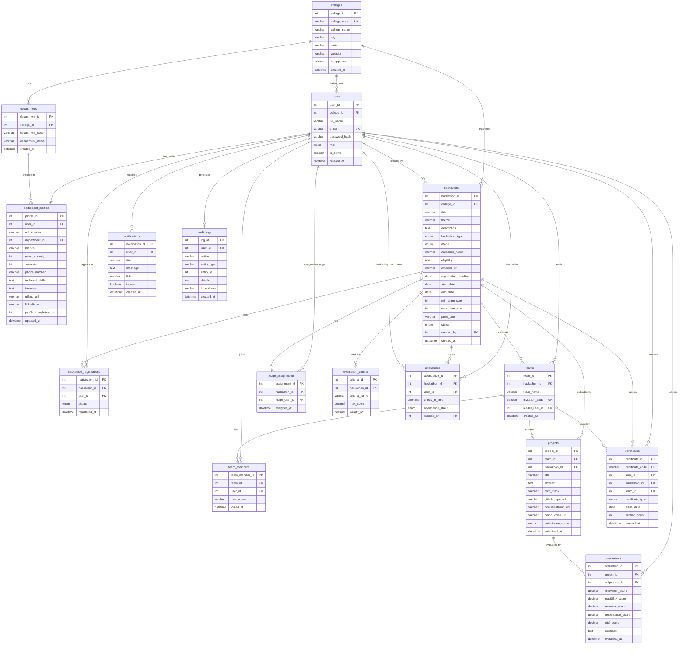

# InnoSphere – Unified Innovation, Hackathon & Research Management Portal

**Course:** Database Management Systems (DBMS) Capstone Project  
**Student:** Atharv Hinge (Second Year Computer Engineering)  
**Academic Year:** 2026 – 2027  
**GitHub Repository:** [https://github.com/AtharvHinge27/DBMS-CP-NEW](https://github.com/AtharvHinge27/DBMS-CP-NEW)  


---

## ⚡ Quick Start: How to Run in 1 Click

You can run the entire portal with a single command or by double-clicking:

### Option A: Windows 1-Click Launch (Recommended)
Simply double-click:
```cmd
run.bat
```
*(Or in PowerShell / Command Prompt, run: `.\run.bat`)*

**What `run.bat` does automatically:**
1. Checks that all Python dependencies (`flask`, `mysql-connector-python`, `reportlab`, etc.) are installed (installs any missing packages automatically).
2. Verifies MySQL server connectivity.
3. Automatically sets up and seeds `innosphere_db` if it hasn't been initialized yet.
4. Starts the Flask server and **automatically opens your web browser** to `http://localhost:5000`!

---

### Option B: Python Command
```bash
python run.py
```

### Option C: Re-seed Database (Reset Data)
To reset and re-populate the sample data at any time:
```cmd
setup.bat
```
*(or run: `python database/setup_db.py`)*

### Option D: Run All Automated Tests
To verify all database triggers, procedures, views, and routes:
```cmd
test.bat
```

---

## 1. Project Vision & Architecture

**InnoSphere** is a modern, light-themed institutional portal designed to manage students, multi-college participants, internal campus hackathons, external national opportunities (e.g. Smart India Hackathon, National Challenges), teams, project submissions, and judge evaluations.

The platform is architected for multi-institution scalability using a normalized **MySQL 8.0** relational database, a modular **Python Flask** backend, and a modern **HTML5/Bootstrap 5/Fetch API** frontend.

---

## 2. Key Modules & Features

### A. Authentication & Role-Based Access Control (RBAC)
- 5 distinct user roles: **Admin**, **College Coordinator**, **Participant**, **Mentor**, and **Judge**.
- Secure password hashing using PBKDF2/SHA-256 (`scrypt`/`werkzeug.security`).
- Role-adaptive dashboards tailored to each user type.

### B. Participant 360° Profile Management
- Academic records: Roll number, Department, Branch, Year of study (1–4), Semester (1–8).
- Technical skills badges, innovation interests, GitHub repository, and LinkedIn links.
- **Dynamic Profile Completion Percentage (0–100%)** calculated in real time by database stored function `fn_calculate_profile_completion()`.
- Participation history tracking: registered hackathons, active teams, project submissions, and earned certificates.

### C. Internal & External Hackathon Management
- **Internal Hackathons:** Created and governed by college administrators or coordinators with customizable eligibility, team sizes, and timelines.
- **External Opportunities:** National competitions (SIH, National Challenges) with direct external application URLs.
- Real-time search filters by opportunity type (All, Internal, External) and status (Open, In Progress, Completed).

### D. Team Collaboration & Project Submission
- Transactional team creation with auto-generated unique invitation codes (e.g. `INNO-CRAFT1`).
- Join team by invitation code with strict database capacity checks.
- Project submission portal: Project Title, Abstract, Tech Stack, GitHub Repository URL, Architecture Docs URL, and Demo Video URL.
- Automated notifications dispatched to all team members upon project submission via database triggers.

### E. Evaluation, Real-Time Leaderboard & Attendance
- Judge assignment to specific hackathons.
- 4-factor scoring rubric: **Innovation (25 pts)**, **Feasibility (25 pts)**, **Technical Execution (25 pts)**, and **Presentation (25 pts)** totaling **100 pts**.
- Real-time **Leaderboard View** (`vw_hackathon_leaderboard`) using SQL Window Function `DENSE_RANK()`.
- Official attendance roster marked by College Coordinators.

### F. Verifiable Digital Certificates
- Cryptographically unique certificate verification codes (e.g. `INNO-2026-WIN001`).
- Public verification portal (`/verify-certificate`) with lookup and verification counter.
- Publication-grade PDF certificate generation on the fly using `reportlab`.

---

## 3. DBMS Concepts Actually Implemented in InnoSphere

| DBMS Concept | Implementation in InnoSphere | Source File |
| :--- | :--- | :--- |
| **3NF Normalization** | 16 tables decomposed to eliminate repeating groups, partial dependencies, and transitive dependencies | `database/02_create_tables.sql` |
| **Referential Integrity** | `ON DELETE CASCADE` for bridge records; `ON DELETE RESTRICT` for active team leaders | `database/02_create_tables.sql` |
| **Domain Constraints** | `CHECK (end_date >= start_date)`, `CHECK (total_score BETWEEN 0 AND 100)` | `database/02_create_tables.sql` |
| **B-Tree Indexes** | Speed up lookups on `users(role)`, `certificates(certificate_code)`, `hackathons(status)` | `database/03_indexes.sql` |
| **Database Views** | `vw_hackathon_leaderboard` (with `DENSE_RANK()`), `vw_participant_summary`, `vw_hackathon_statistics` | `database/04_views.sql` |
| **Stored Functions** | `fn_calculate_profile_completion(user_id)` computes completion % dynamically | `database/05_functions.sql` |
| **Stored Procedures** | `sp_create_team_with_leader`, `sp_join_team_by_code`, `sp_record_evaluation`, `sp_issue_certificate` | `database/06_stored_procedures.sql` |
| **ACID Transactions** | `START TRANSACTION`, `COMMIT`, `ROLLBACK` on `SQLEXCEPTION` handler in team creation | `database/06_stored_procedures.sql` |
| **Database Triggers** | `trg_after_user_insert` (auto-initializes profile), `trg_before_evaluation_insert` (validates scores), `trg_after_project_insert` (notifies team) | `database/07_triggers.sql` |
| **Complex Joins** | Multi-table `INNER JOIN` and `LEFT OUTER JOIN` across 5 tables in views and reports | `database/04_views.sql`, `database/09_advanced_queries.sql` |
| **GROUP BY & HAVING** | Participation aggregation filtering colleges with $\ge 2$ students | `database/09_advanced_queries.sql` |

---

## 4. Entity Relationship (ER) Diagram

The InnoSphere database consists of **16 normalized tables** (3NF) spanning authentication, hackathon management, teams, projects, evaluations, certificates, and audit logging.



### Key Relationships Explained

| Relationship | Type | Description |
|---|---|---|
| `colleges` → `departments` | 1 : Many | A college can have multiple departments |
| `colleges` → `users` | 1 : Many | Users are tenant-scoped to a college |
| `users` → `participant_profiles` | **1 : 1** | Every participant has exactly one profile; created automatically by trigger |
| `hackathons` → `hackathon_registrations` | 1 : Many | A hackathon can have many individual applicants |
| `hackathons` → `teams` | 1 : Many | Multiple teams compete in a hackathon |
| `teams` ↔ `users` via `team_members` | **Many : Many** | Bridge table; a user can be in multiple teams across different hackathons |
| `teams` → `projects` | **1 : 1** | Each team submits exactly one project per hackathon |
| `projects` → `evaluations` | 1 : Many | A project is scored by multiple judges |
| `hackathons` → `judge_assignments` | Many : Many | Multiple judges assigned to each hackathon |
| `users` → `certificates` | 1 : Many | A user can earn certificates from multiple hackathons |
| `users` → `audit_logs` | 1 : Many | Every sensitive action is logged per user |

---

## 5. Technology Stack & Prerequisites

- **Frontend:** HTML5, CSS3, JavaScript (Fetch API), Bootstrap 5.3, Bootstrap Icons
- **Backend:** Python 3.11+ / Flask 3.1
- **Database:** MySQL Server 8.0+ (InnoDB Engine)
- **Database Connectivity:** `mysql-connector-python`
- **Dependencies:** `Flask`, `mysql-connector-python`, `python-dotenv`, `werkzeug`, `reportlab`, `python-docx`

---

## 6. Installation & Setup Instructions

### Step 1: Clone Repository & Navigate
```bash
git clone https://github.com/AtharvHinge27/DBMS-CP-NEW.git
cd "d:\DBMS CP NEW"
```

### Step 2: Install Python Dependencies
```bash
pip install -r requirements.txt
```

### Step 3: Configure Environment Variables
Ensure `.env` contains your MySQL credentials:
```env
DB_HOST=localhost
DB_PORT=3306
DB_USER=root
DB_PASSWORD=your_mysql_password_here
DB_NAME=innosphere_db
SECRET_KEY=your_flask_secret_key_here
FLASK_ENV=development
PORT=5000
```

### Step 4: Initialize and Seed MySQL Database
Run the automated initialization script to build all 16 tables, 4 views, 4 stored procedures, 3 functions, 4 triggers, and sample data:
```bash
python database/setup_db.py
```

### Step 5: Start the Flask Application
```bash
python app.py
```
Open your browser and navigate to: **`http://localhost:5000`**

---

## 7. Demo Accounts for Faculty & Viva Testing

You can use the one-click autofill buttons on the login page (`/login`) or enter these credentials:

| Role | Email Address | Password | Description |
| :--- | :--- | :--- | :--- |
| **Admin** | `admin@innosphere.edu` | `admin123` | Full portal governance, colleges, and audit logs |
| **Coordinator** | `coord@pict.edu` | `coord123` | Campus event management and attendance tracking |
| **Participant** | `atharv@pict.edu` | `student123` | Student innovator (Atharv Hinge, Leader of CodeCrafters) |
| **Participant** | `sneha.rao@coep.ac.in`| `student123` | Student innovator (Sneha Rao, Leader of NeuralNomads) |
| **Judge** | `judge.sharma@innosphere.edu`| `judge123` | Dr. Anand Sharma (Assigned judge for evaluations) |
| **Mentor** | `mentor@innosphere.edu` | `mentor123` | Faculty Research Mentor |

---

## 8. Running Unit & Integration Tests

The project includes unit and integration tests covering database triggers, procedures, views, API routes, and PDF downloads:

```bash
# 1. Test database integrity, triggers, stored functions, and ACID procedures
python tests/test_db.py

# 2. Test REST API endpoints across auth, hackathons, teams, and leaderboard
python tests/test_api.py

# 3. Test all 14 frontend pages and error handlers
python tests/test_routes.py
```

---

## 9. Academic Word Documentation

The complete academic viva guide and DBMS project documentation is generated at:
`docs/InnoSphere_DBMS_Project_Documentation.docx`

To regenerate this document at any time:
```bash
python docs/generate_doc.py
```
